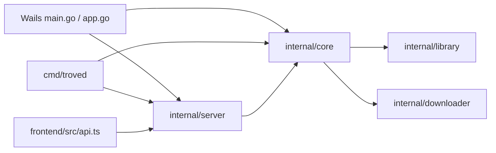

# Architecture and code map

## Current runtime

The desktop starts an in-process HTTP server; api.ts resolves APIBase through Wails. Browser clients use same-origin HTTP. Native file dialogs and OS integration remain desktop adapters. SSE at `/api/events` carries updates. The desktop embeds `frontend/dist` from main.go, so moving the frontend affects the Go build.

| Boundary | Current owner | Responsibility |
| --- | --- | --- |
| Desktop lifecycle/native actions | ../main.go, ../app.go | Wails startup, assets, OS integration |
| Headless host | ../cmd/troved/ | CLI configuration and server startup |
| Application services | ../internal/core/ | Queue/catalogue orchestration, media, trash, collections, maintenance |
| Persistence/domain | ../internal/library/ | SQLite/catalogue, memberships, people, duplicates, filesystem semantics |
| Download execution | ../internal/downloader/ | Processes, parsing progress, cancellation and cleanup |
| HTTP/events | ../internal/server/ | Routes, validation/transport, SSE |
| Frontend transport | ../frontend/src/api.ts, httpResponse.ts | HTTP/native boundary, readable errors |
| Shell/routing/state | ../frontend/src/Manager.tsx | Navigation, video scope, dialogs and page composition |
| Legacy player/app | ../frontend/src/App.tsx, VideoPlayer.tsx | Existing player implementation and remaining legacy dependencies |
| Media pages | PhotoBrowser.tsx, AlbumBrowser.tsx | Photo and collection state and rendering |
| Directories/utilities | PeopleDirectory.tsx, TagsDirectory.tsx, Following.tsx, LibraryUtilities.tsx | Browse people/tags, sources and queue/settings |
| Shared UI | UIControls.tsx, WorkspaceUI.tsx, PopoverPosition.ts | Controls, page/browse structure, menu geometry |

Frontend filenames without a directory in the table are under frontend/src. Backend directories are relative to docs/. The table is a locator, not a claim that every dependency is already ideal.

## Dependency rules
Future UI packages must accept data/callbacks and have no dependency on app routes, api.ts, generated Wails models or vault paths. Apps may depend on packages; packages must not import apps. API contracts must be serializable and independent of React and Wails. Native adapters belong to the desktop host. Core/domain code should not depend on React or the desktop runtime.

## Known architecture debt
Manager.tsx and App.tsx combine too many responsibilities; the source tree is mostly flat; generated Wails model types leak into UI; theme sheets still contain legacy selectors. npm workspaces now use one root lockfile; @clipkit/design-tokens is the first private shared package. The frontend retains an import-only tokens.css shim. These are migration tasks, not reasons to move every file at once. See repository-evolution.md for gates and sequencing.

Generated/build outputs: frontend/wailsjs, frontend/dist and build/bin. Do not treat them as hand-maintained source. Local executables/databases in the root are not architecture examples or fixtures.
